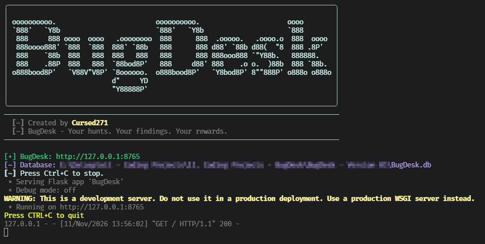
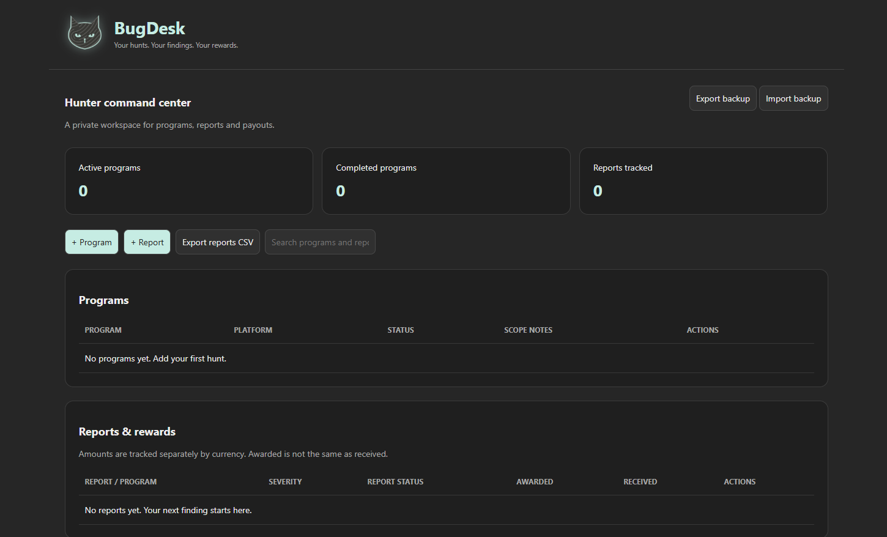

<div align="center">

  

  <h1>BugDesk</h1>

  <p align="center">
    
  </p>

  <p align="center">
    
    
    
    
    <a href="./LICENSE">
      
    </a>
  </p>

  <p>Your Hunts. Your Findings. Your Rewards.</p>

</div>


## Overview

BugDesk is a local bug-bounty operations dashboard for tracking programs, findings, reports, and rewards.

It runs a localhost-only Flask web interface, persists workflow data in SQLite, validates imported JSON backups, retains recovery snapshots before state changes, and supports JSON export through the browser dashboard.

> BugDesk is designed for personal bug-bounty workflow management. It does not submit reports, interact with bounty platforms, automate discovery, or make payout claims on your behalf.

## Features

| Capability | What it does |
| :--- | :--- |
| Program tracking | Records bug-bounty programs with platform, scope, and lifecycle status. |
| Finding tracking | Records vulnerability findings, affected assets, discovery dates, severity, and workflow status. |
| Report tracking | Tracks report progression from draft through triage, acceptance, resolution, duplicate, informative, out-of-scope, or not-applicable states. |
| Reward tracking | Records awarded and received bounty amounts using integer hundredths of a selected currency. |
| Finding linkage | Links a report to one finding and prevents duplicate finding-to-report links. |
| SQLite persistence | Stores dashboard state locally in `BugDesk.db`. |
| JSON backup export | Supports browser-based export of the current version 2 state. |
| JSON backup import | Replaces current dashboard state with a validated version 2 JSON backup before launch. |
| Recovery snapshots | Retains the prior state before each successful save, keeping the latest 20 recovery records. |
| Localhost-only interface | Binds the Flask server to `127.0.0.1` and restricts API requests to loopback origins. |
| Token-protected API | Requires a per-launch random token for `/api/` requests. |
| Browser launch | Opens the dashboard automatically unless browser launch is disabled. |

## Screenshots:

### CLI Interface


### Dashboard Interface


## Workflow Model

BugDesk organizes bug-bounty work into three linked record types.

| Record type | Purpose | Available statuses |
| :--- | :--- | :--- |
| Program | Represents a bug-bounty program or target engagement | `Ongoing`, `Paused`, `Completed` |
| Finding | Represents a potential security issue or research observation | `Investigating`, `Confirmed`, `Ready to report`, `Reported`, `Discarded` |
| Report | Represents a submitted report and its reward lifecycle | `Draft`, `Submitted`, `Triaged`, `Accepted`, `Resolved`, `Duplicate`, `Informative`, `Out of scope`, `Not applicable` |

Findings and reports must reference an existing program. A report may reference one finding, and each finding can be linked to only one report.

## Severity Model

| Severity | Intended use |
| :--- | :--- |
| `Unassessed` | Initial record state before impact analysis |
| `Critical` | Critical-impact findings |
| `High` | High-impact findings |
| `Medium` | Moderate-impact findings |
| `Low` | Limited-impact findings |
| `Informational` | Non-security or low-impact observations |

Severity labels are workflow metadata. They do not automatically determine platform triage decisions, payout eligibility, or report validity.

## Technology

| Component | Purpose |
| :--- | :--- |
| Python | Application runtime |
| Flask | Local dashboard web server and JSON API |
| SQLite | Local persistent state storage |
| Typer | Command-line options and help |
| Rich | Banner, status messages, and terminal output |
| HTML / JavaScript | Browser dashboard interface |
| json | Version 2 state serialization, import, and export |
| secrets | Per-launch API-token generation |
| threading | Delayed browser launch |
| webbrowser | Automatic dashboard opening |
| pathlib | Database, HTML, and import-path handling |

## Installation

### Prerequisites

- Python 3 with `pip`.
- A modern desktop browser.
- `BugDesk.html` in the same directory as `BugDesk.py`.
- Write access to the directory containing `BugDesk.py`.

Install dependencies:

```bash
python3 -m pip install flask rich typer
```

Clone and launch:

```bash
git clone https://github.com/Cursed271/BugDesk.git
cd BugDesk
python3 BugDesk.py
```

Use an isolated Python environment. If your environment uses `python` rather than `python3`, substitute that interpreter consistently.

## Usage

### Launch the Dashboard

```bash
python3 BugDesk.py
```

BugDesk initializes its local database, starts a localhost-only Flask server, and opens the dashboard in the default browser.

### Launch Without a Browser

```bash
python3 BugDesk.py --no-browser
```

### Use a Custom Port

```bash
python3 BugDesk.py --port 9000
```

### Import a JSON Backup

```bash
python3 BugDesk.py --import-json bugdesk-backup.json
```

The import replaces the current dashboard state with the validated version 2 backup. The prior state is retained in the recovery-snapshot table.

### Display Help

```bash
python3 BugDesk.py --help
```

## Command-Line Options

| Option | Short | Default | Purpose |
| :--- | :--- | :--- | :--- |
| `--port` | `-p` | `8765` | Local dashboard port; must be between 1024 and 65535 |
| `--no-browser` | — | Disabled | Starts the server without opening a browser |
| `--import-json` | `-i` | None | Imports and validates a version 2 JSON backup before launch |
| `--help` | `-h` | — | Show help |

## Data Model

### Programs

| Field | Requirement | Purpose |
| :--- | :--- | :--- |
| `id` | Required, unique | Stable program identifier |
| `name` | Required | Program or engagement name |
| `platform` | Required | Bounty platform or program source |
| `scope` | Optional | Authorized testing scope or notes |
| `status` | Required | Program lifecycle status |

### Findings

| Field | Requirement | Purpose |
| :--- | :--- | :--- |
| `id` | Required, unique | Stable finding identifier |
| `title` | Required | Finding title |
| `program` | Required | Linked program ID |
| `type` | Optional | Vulnerability or issue category |
| `asset` | Optional | Affected asset or endpoint |
| `discovered` | Optional | ISO-format discovery date |
| `severity` | Required | Severity classification |
| `notes` | Optional | Assessment notes |
| `status` | Required | Finding workflow status |

### Reports

| Field | Requirement | Purpose |
| :--- | :--- | :--- |
| `id` | Required, unique | Stable report identifier |
| `title` | Required | Report title |
| `program` | Required | Linked program ID |
| `finding` | Optional | Linked finding ID |
| `status` | Required | Report lifecycle status |
| `severity` | Required | Severity classification |
| `currency` | Required | Three-letter uppercase currency code |
| `awarded` | Required | Awarded amount in integer hundredths |
| `received` | Required | Received amount in integer hundredths |
| `payment_date` | Optional | ISO-format payment date |
| `url` | Optional | Report or tracking URL |
| `notes` | Optional | Report notes |

## Currency & Rewards

BugDesk stores monetary values as integer hundredths of a currency unit.

| Desired display value | Stored integer value |
| :--- | :--- |
| 100.00 | `10000` |
| 250.50 | `25050` |
| 1,000.00 | `100000` |

This approach avoids floating-point currency errors. The received amount cannot exceed the awarded amount.

## Security Model

| Control | Behavior |
| :--- | :--- |
| Network binding | The Flask server binds only to `127.0.0.1`. |
| Host validation | Requests must use the configured localhost host and port. |
| API authorization | `/api/` requests require a per-launch random `X-BugDesk-Token` header. |
| Token injection | The dashboard HTML receives the current launch token. |
| Request-size limit | Request bodies are limited to 10 MB. |
| Save concurrency | Optimistic revision checking prevents an older tab from overwriting newer data. |
| Recovery snapshots | The prior state is retained before each successful save. |
| Response headers | Applies `no-store`, `X-Content-Type-Options: nosniff`, `X-Frame-Options: DENY`, and `Referrer-Policy: no-referrer`. |

## Backup & Recovery

### JSON Backups

BugDesk uses a version 2 JSON structure containing:

- `version`
- `programs`
- `findings`
- `reports`

Use the dashboard export function to create a backup before major changes, migration, or application updates.

### Recovery Snapshots

Before each successful save, BugDesk stores the immediately preceding state in its `recovery` table. It retains the latest 20 snapshots.

Recovery snapshots are local database records, not standalone JSON files. Use SQLite tooling or a database backup process to preserve them outside the application directory.

### Import Behavior

JSON import replaces the active dashboard state. It is a destructive operation relative to the current working state, although the immediately preceding state is retained as a recovery snapshot.

## Known Limitations

- BugDesk is localhost-only and is not intended for multi-user or network-shared deployment.
- The dashboard requires `BugDesk.html` beside `BugDesk.py`.
- JSON import replaces the current state rather than merging records.
- The recovery table retains only the latest 20 snapshots.
- No user authentication, password protection, encryption-at-rest, or multi-device synchronization is implemented.
- The SQLite database and recovery snapshots are readable by any process or user with filesystem access.
- The dashboard does not automatically synchronize with HackerOne, Bugcrowd, Intigriti, or other bounty platforms.
- The tool does not validate whether a reported issue is technically valid, in scope, or eligible for payment.
- A stale-save conflict requires reloading the dashboard before further edits.

## Safe Use

- Keep `BugDesk.db`, JSON backups, and recovery data private.
- Do not store credentials, private program invitations, unreleased vulnerability details, or client-confidential material in the dashboard.
- Export and back up important data before importing a JSON backup.
- Use a dedicated local port and avoid exposing BugDesk through a reverse proxy or public interface.
- Review the program scope before recording targets, assets, or findings.
- Treat bounty values as internal workflow data until payment is confirmed by the platform.

## Troubleshooting

| Problem | What to check |
| :--- | :--- |
| Dashboard does not open | Browser availability, `--no-browser`, and the displayed localhost URL |
| Port already in use | Another local service using the selected port; choose a different `--port` |
| Older database error | Legacy Tkinter database detected; back it up and run BugDesk from a separate directory |
| Import rejected | JSON version, record structure, IDs, statuses, currency code, dates, and amount fields |
| Stale-save error | Another dashboard tab saved newer data; reload before editing |
| Missing HTML | Ensure `BugDesk.html` is in the same directory as `BugDesk.py` |
| Database save failure | Disk space, file permissions, SQLite availability, and database integrity |

## Version History

| Version | Scope |
| :--- | :--- |
| Version 1 | Tkinter-based local bug-bounty workflow tracking |
| Version 2 | Flask localhost dashboard, SQLite persistence, JSON import/export, recovery snapshots, token-protected API, and reward tracking |

## License & Usage

BugDesk is distributed under the CursedSec Ownership Edict (COE).

Read [LICENSE](./LICENSE) for the applicable permissions, restrictions, contribution terms, and disclaimers. Public source availability is not a substitute for those terms.

## Feedback & Contributions

Use the repository's bug-report or feature-request template when issue submission is available.

Include the version, operating system, browser, sanitized command, and reproduction steps. Never publish private program invitations, unreleased findings, credentials, client information, or sensitive bounty data.

Check the security-reporting instructions before disclosing a vulnerability. Review the license and contribution terms before submitting modifications.

## Connect & Collaborate

<div align="center">

  <a href="https://github.com/Cursed271">
    
  </a>
  <a href="https://www.cursedsec.com/">
    
  </a>
  <a href="https://www.linkedin.com/in/cursed271/">
    
  </a>

  <p>Track the hunt. Protect the finding. Document the reward.</p>
  <sub>CursedSec.com · Cursed271 · BugDesk</sub>

</div>


